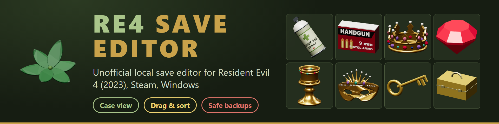
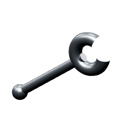
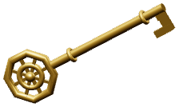
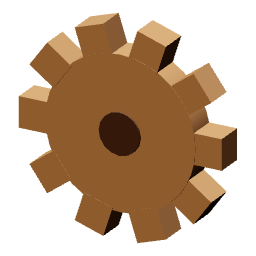
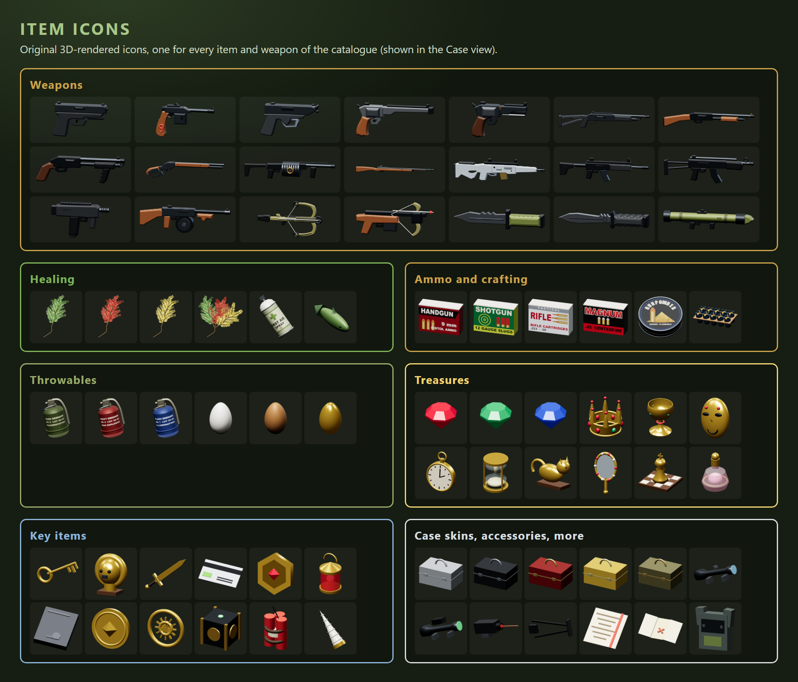
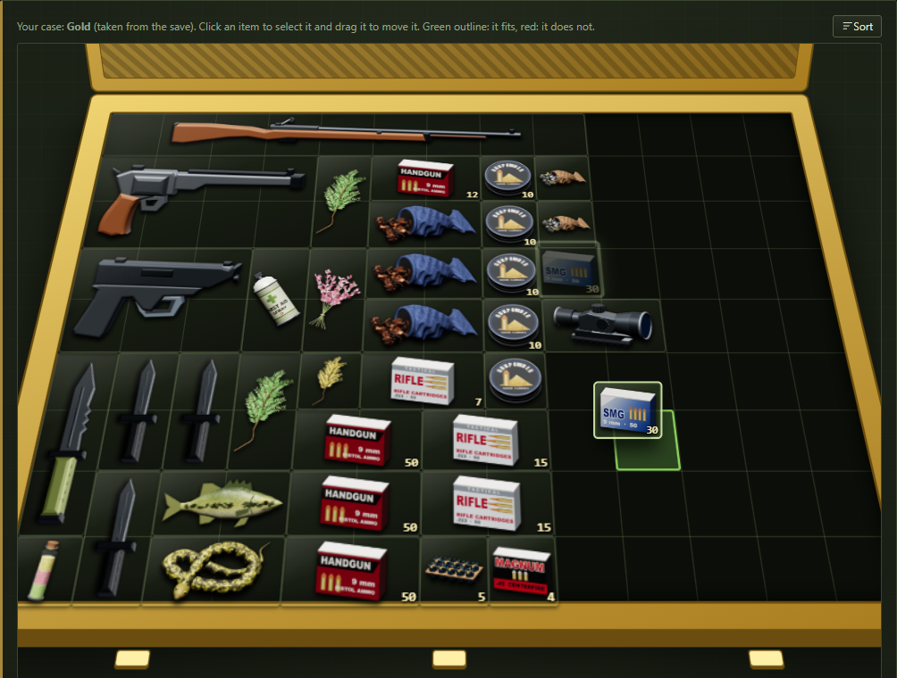
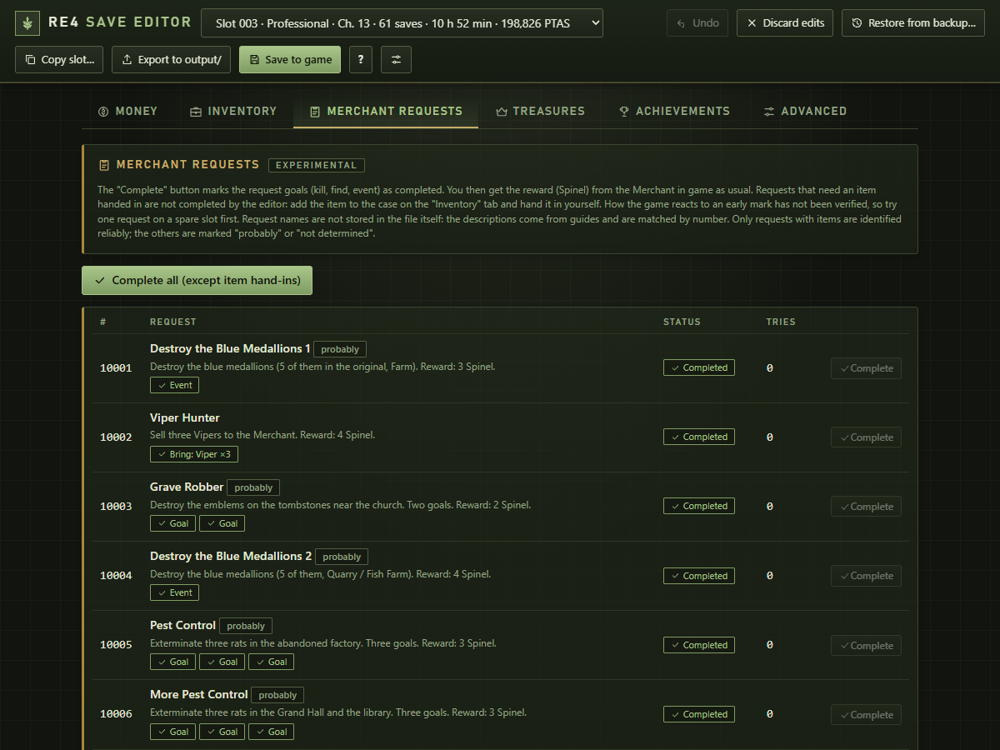
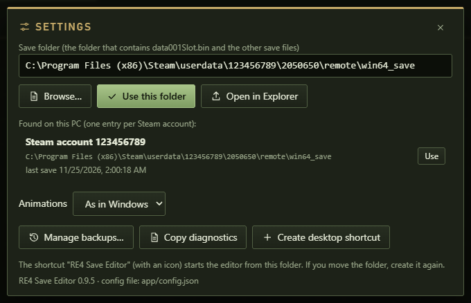

<p align="center"></p>

<p align="center"><a href="https://github.com/distrix11/RE4-Remake-Save-Editor/releases"></a>&nbsp;&nbsp;<a href="https://www.nexusmods.com/residentevil42023/mods/8173?tab=files"></a></p>
<p align="center"><b>GitHub:</b> nothing to install, extract the zip and double-click <code>Start RE4 Save Editor.js</code>.<br><b>Nexus Mods:</b> script package, needs <a href="https://nodejs.org">Node.js</a> 20+, double-click <code>Start RE4 Save Editor.js</code>.</p>

# RE4 Remake Save Editor

An unofficial, local web-based save editor for **Resident Evil 4 (2023 remake) on Steam** (Windows).
It runs on your own computer, opens in your browser or its own window and never sends your data anywhere.

> [!WARNING]
> **Not affiliated with Capcom or Valve. Use at your own risk.**
> Editing saves can corrupt them. The editor makes a backup before every write, but keep your own copies too.

> [!NOTE]
> This is a pre-release (0.9.5). It has been tested on a limited set of saves; please report what you find.

**New in 0.9.5:** Undo, keyboard keys in the Case view, a space check when adding weapons, pictures in the Inventory lists, many item icons redrawn, and fixed sizes of three accessories. [Release notes](https://github.com/distrix11/RE4-Remake-Save-Editor/releases/tag/v0.9.5)

## Features

-  **Money**: Pesetas and Spinel.
-  **Inventory** (attaché case, key items, treasures, recipes/charms):
  search, category filter, sorting; edit counts, ammo, durability and item IDs;
  **add** items from a catalog of ~220 items, **duplicate**, **delete**;
  **case size** selector; a **Case view** (the case lying down, like in the game) where items are moved by dragging and rotated; **weapon upgrades** (levels 0-4, a **Full upgrade** button and the exclusive upgrade switch), **Add weapon…** (a new weapon from a built-in list, or a copy from another of your slots, with its picture and whether it fits the case now) and a **Sort** button that tidies the case; **Undo** (button or Ctrl+Z) takes back the last changes one by one.
-  **Merchant requests**: shows the goals of every request and can mark the goals as completed.
-  **Treasures**: which treasure types you have obtained and how many world pickups are recorded per area (approximate).
-  **Achievements**: reads your local Steam achievement cache (read-only) and shows progress hints computed from the save.
  It cannot unlock achievements.
-  **Safety**: a "game is running" warning, a notice when the slot file was changed outside the editor (with a reload button), an unsaved-changes indicator, a summary of every change before writing,
  automatic backups, restore from a backup or from your own file, and copying one slot into another.
-  **Settings**: choose the save folder or Steam account inside the editor, backup manager, "Copy diagnostics" for bug reports (no personal data), **Create desktop shortcut** (with an icon) and **Animations** (as in Windows, on or off).
-  **Safe writes**: the file is written under a temporary name, decrypted back and compared before it replaces the original.
  The first time the editor runs it keeps a protected copy of every slot. If a game update changes the save layout,
  adding, moving and removing items is disabled and a banner explains why.
-  **Case view**: a pale-green theme in the spirit of the original game and a static perspective view of your attaché case with 3D-rendered item icons.
  The case takes the look (Silver, Black, Leather, Gold, Classic) of the skin selected in your save. Every catalogue item has its own icon (original 3D models, weapons included, rendered by `scripts/icon-render`); you can add your own pictures for any item in `icons/user/<item id>.png`. Items are moved by dragging them in the Case view; for the selected item R rotates (its picture turns too), Delete removes, the arrows move and Esc deselects.
-  **Motion**: a start screen, the attaché case opens, items slide and settle into their cells, soft transitions between tabs and windows. If animation effects are turned off in Windows, choose Settings > Animations > On to see them.
-  **Updates and About**: once a day (can be turned off in the **?** dialog) the editor asks GitHub for the latest release number and offers to open the download page. Nothing is downloaded or installed automatically, and no personal data is sent.
-  **Advanced**: a raw tree view of every field in the save file with search.

## Item icons

<p align="center"></p>

Every item of the catalogue has its own icon. They are rendered from original 3D models written for this project (`scripts/icon-render`), so there is nothing from the game in the repository.

## Screenshots

| | |
|---|---|
|  |  |
|  |  |
|  |  |
|  |  |

## Requirements

- Windows 10 / 11, Steam version of Resident Evil 4 (2023)
- GitHub archive: nothing else, it bundles Node.js. The Nexus Mods package (`Start RE4 Save Editor.js`) needs [Node.js](https://nodejs.org) 20 or newer installed.
- Building from source: [Node.js](https://nodejs.org) 20 or newer, [git](https://git-scm.com) and internet access for the first build

## Quick start

### Option A: release archive (no build)

Download from [GitHub Releases](https://github.com/distrix11/RE4-Remake-Save-Editor/releases) or from [Nexus Mods](https://www.nexusmods.com/residentevil42023/mods/8173?tab=files), extract anywhere (into a new folder when updating) and start it:

- GitHub, `...-windows-allinone.zip` (nothing to install and nothing to download): double-click `Start RE4 Save Editor.js`.
  The editor opens in its own app-style window (Edge or Chrome in `--app` mode; the default browser is used if neither is found). Closing the window stops the editor.
  The only program in the archive is `runtime/node.exe`, the unmodified official Node.js signed by the OpenJS Foundation; everything else is readable JavaScript.
  Windows may ask once whether to run the script; if it opens in a text editor, use "Open with > Microsoft Windows Based Script Host".
  SHA-256 sums and a VirusTotal link are in the notes of each release.
- Nexus Mods, script-only package (it has no `.exe`, `.dll` or `.bat` because Nexus does not accept them): double-click `Start RE4 Save Editor.js`. It needs [Node.js](https://nodejs.org) 20 or newer (install the LTS version once); if it is missing, a message offers to open the download page. Windows may ask once whether to run the script; if it opens in a text editor, use "Open with > Microsoft Windows Based Script Host".

If you prefer a terminal: `node app/server.js` opens the editor in your browser at http://localhost:4784 (close the black window to stop it).
`scripts/make-dist.js` builds the archives (`--allinone yes` adds the all-in-one one); a GitHub Actions workflow does it for tags.

### Option B: build from source

```text
git clone https://github.com/distrix11/RE4-Remake-Save-Editor.git
cd RE4-Remake-Save-Editor
build.bat     (one time: downloads the field name templates and builds the name dictionary)
start.bat     (opens the editor in its own window)
```

> [!IMPORTANT]
> It is best to **close the game** before saving, and consider turning off Steam Cloud for RE4 (otherwise Steam may restore the old file).
>
> Writing while the game is running (for example from its main menu, then loading the slot) has worked in tests, because the game reads the file when you load it; but if the game saves over the file afterwards (autosave), your edit is lost. Closing the game is the safe way.

1. Start the editor (see above).
2. Pick a slot in the drop-down list at the top, edit, then press **Save to game**. A summary of the changes is shown first.
3. Use **Restore from backup...** to undo a write at any time.

The save folder (`<Steam>/userdata/<account>/2050650/remote/win64_save`) is detected automatically.

> [!TIP]
> If detection fails (or you have several Steam accounts), use the gear button in the editor.
> See `docs/TESTING.md` for an in-game test checklist.

## How it works

Steam save files are encrypted with the account's SteamID. Decryption and encryption are done in JavaScript (`app/lime.js`),
a port of [LimebrellaSharp](https://github.com/mi5hmash/LimebrellaSharp) that was checked byte for byte against the original. The decrypted data is a reflection-style
binary format; field names are hashed and are resolved with the class templates from
[RE_RSZ](https://github.com/alphazolam/RE_RSZ). See [FORMAT.md](FORMAT.md) for what is known about the format.
Edits are applied in place, and structural changes (adding or removing items) re-emit the file with the
alignment recomputed. Nothing is written to the game folder without a backup.

## Known limitations

- Item sizes in the case are **estimates** inferred from real layouts; items may look different in game.
- Weapon upgrade levels are limited to 0-4 (the highest seen in real saves). Some weapons have fewer upgrades; the editor does not know which.
- **Add weapon…** offers new weapons (no upgrades, empty magazine) only for the weapons in its built-in list: not for the main-game W-870, Striker, TMP, CQBR, Broken Butterfly, Bolt Thrower, the rocket launchers and some knives. A weapon from another of your slots of the same campaign can be copied too. The game deletes weapons of the other campaign, bonus or DLC weapons you have not unlocked (for example the Chicago Sweeper), weapons that do not fit the case, and may delete a second copy of one you already carry. The exclusive upgrade is a 0/1 switch and needs every other upgrade at 4.
- Names of merchant requests are not stored in the save; the mapping is partly inferred and marked in the UI.
- The item catalog is community-compiled and may contain mistakes.
- Tested on a limited set of saves and one game version (see `docs/TESTING.md` for the in-game checklist). Game patches may change the save format.
- Windows and the Steam version only.

## Contributing

Issues and pull requests are welcome. Please **do not attach your save files** to an issue: a save file is tied to your Steam account number
(the number that identifies your Steam profile; it is not your password, e-mail or payment data), and that number can be worked out from the file,
so an attached save would make it public. The **Copy diagnostics** button (Settings) makes a report without it: describe the problem and paste that report instead.

## License

[MIT](LICENSE). Third-party components and data sources: see [THIRD_PARTY_NOTICES.md](THIRD_PARTY_NOTICES.md).
