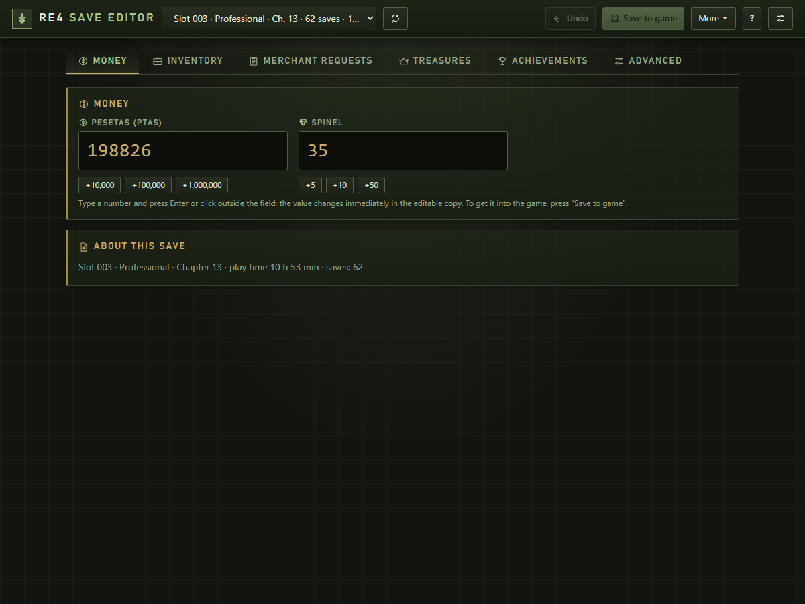
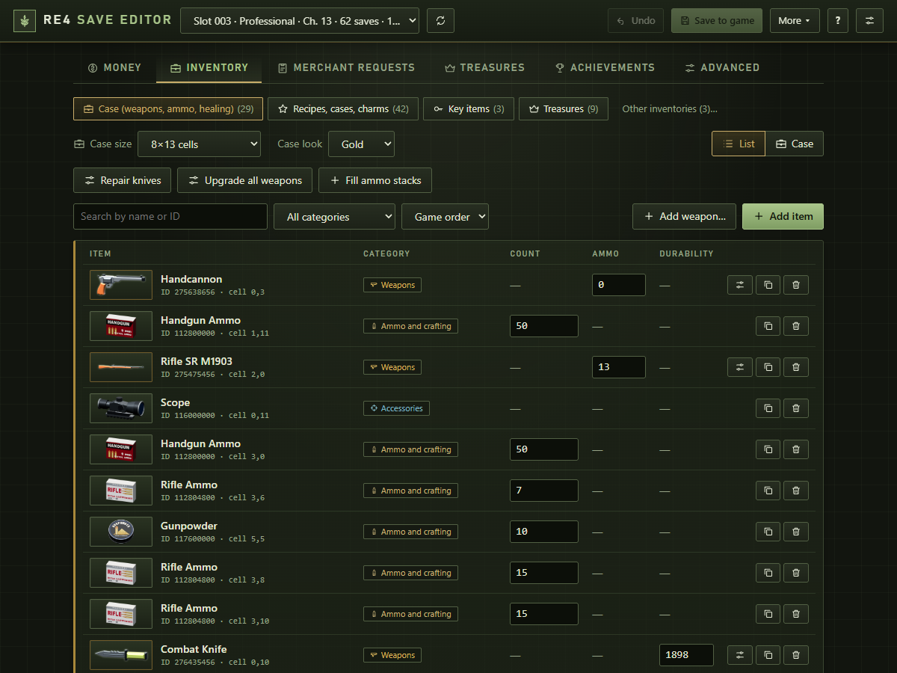
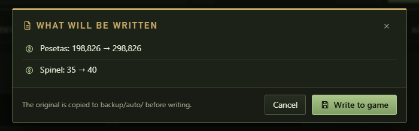
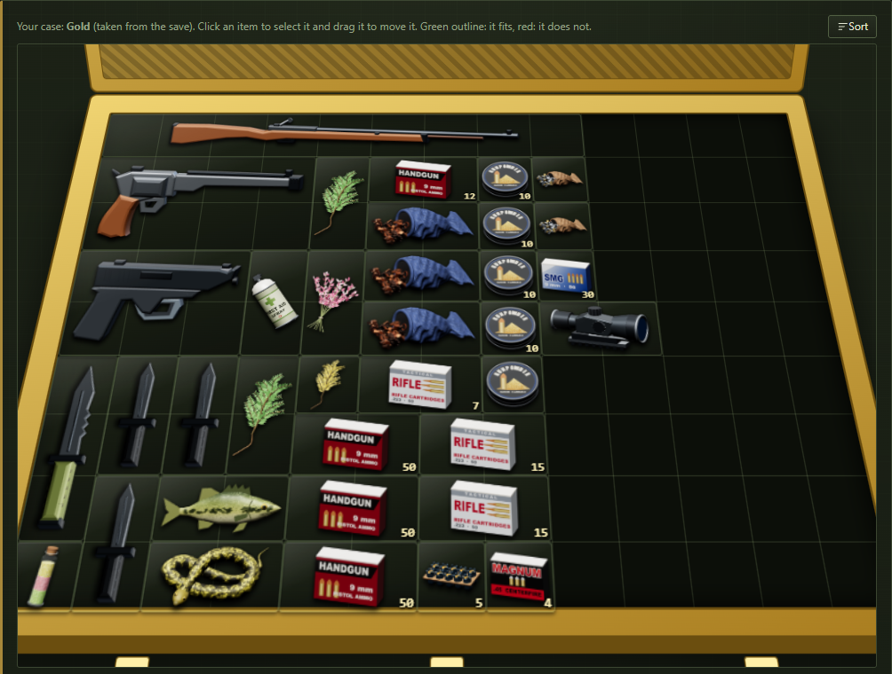

# RE4 Remake Save Editor

An unofficial, local web-based save editor for **Resident Evil 4 (2023 remake) on Steam** (Windows).
It runs on your own computer, opens in your browser and never sends anything over the network.

> **Not affiliated with Capcom or Valve. Use at your own risk.**
> Editing saves can corrupt them. The editor makes a backup before every write, but keep your own copies too.

## Features

- **Money**: Pesetas and Spinel.
- **Inventory** (attaché case, key items, treasures, recipes/charms):
  search, category filter, sorting; edit counts, ammo, durability and item IDs;
  **add** items from a catalog of ~220 items, **duplicate**, **delete**;
  **case size** selector; a **Case view** (the case lying down, like in the game) where items are moved by dragging and rotated; **weapon upgrade levels**.
- **Merchant requests**: shows the goals of every request and can mark the goals as completed.
- **Treasures**: which treasure types you have obtained and how many world pickups are recorded per area (approximate).
- **Achievements**: reads your local Steam achievement cache (read-only) and shows progress hints computed from the save.
  It cannot unlock achievements.
- **Safety**: a "game is running" warning, an unsaved-changes indicator, a summary of every change before writing,
  automatic backups, restore from a backup or from your own file, and copying one slot into another.
- **Settings**: choose the save folder or Steam account inside the editor, backup manager, "Copy diagnostics" for bug reports (no personal data).
- **Safe writes**: the file is written under a temporary name, decrypted back and compared before it replaces the original.
  The first time the editor runs it keeps a protected copy of every slot. If a game update changes the save layout,
  adding, moving and removing items is disabled and a banner explains why.
- **Case view**: a pale-green theme in the spirit of the original game and a static perspective view of your attaché case with vector item icons.
  The case takes the look (Silver, Black, Leather, Gold, Classic) of the skin selected in your save. Weapons use pictures rendered from CC0 3D models; you can add your own pictures for any item in `icons/user/<item id>.png`. Items are moved by dragging them in the Case view.
- **Updates and About**: once a day (can be turned off in the **?** dialog) the editor asks GitHub for the latest release number and offers to open the download page. Nothing is downloaded or installed automatically, and no personal data is sent.
- **Advanced**: a raw tree view of every field in the save file with search.

## Screenshots

| | |
|---|---|
|  |  |
|  |  |
|  |  |
|  |  |

## Requirements

- Windows 10 / 11, Steam version of Resident Evil 4 (2023)
- Release archive: nothing else (the all-in-one archive bundles Node.js and the encryptor)
- Building from source: [Node.js](https://nodejs.org) 20 or newer, [git](https://git-scm.com) and internet access for the first build

## Quick start

### Option A: release archive (no build)

Download from GitHub Releases, extract anywhere and pick one:

- `...-windows-allinone.zip` (recommended): double-click `RE4SaveEditor.exe`. Nothing to install. The editor opens in its own app-style window (Edge or Chrome in `--app` mode; the default browser is used if neither is found). Closing the window stops the editor.
  The launcher is about 40 lines of C# (`launcher/Launcher.cs`) that starts the bundled `runtime/node.exe` with `app/server.js`.
  Windows SmartScreen may warn because it is not code-signed. SHA-256 sums are published with each release.
- `...-github.zip`: needs [Node.js](https://nodejs.org) LTS and the [.NET 10 Runtime](https://dotnet.microsoft.com/download/dotnet/10.0); double-click `start.bat`.
- `...-nexus.zip` (Nexus Mods): like the previous one but without any launcher file. Open the folder in Explorer, type `cmd` in the address bar, run `node app/server.js`.

The editor opens in your browser at http://localhost:4784. Close the black window to stop it.
`scripts/make-dist.js` builds the archives (`--allinone yes` adds the all-in-one one); a GitHub Actions workflow does it for tags.

### Option B: build from source

```text
git clone https://github.com/distrix11/RE4-Remake-Save-Editor.git
cd RE4-Remake-Save-Editor
build.bat     (one time: downloads and builds the encryption helper)
start.bat     (opens http://localhost:4784 in your browser)
```

1. **Close the game** and consider turning off Steam Cloud for RE4 (otherwise Steam may restore the old file).
2. Pick a slot in the drop-down list at the top, edit, then press **Save to game**. A summary of the changes is shown first.
3. Use **Restore from copy...** to undo a write at any time.

The save folder (`<Steam>/userdata/<account>/2050650/remote/win64_save`) is detected automatically.
If detection fails (or you have several Steam accounts), use the gear button in the editor. See `docs/TESTING.md` for an in-game test checklist.

## How it works

Steam save files are encrypted with the account's SteamID. Decryption and encryption are delegated to
[LimebrellaSharp](https://github.com/mi5hmash/LimebrellaSharp). The decrypted data is a reflection-style
binary format; field names are hashed and are resolved with the class templates from
[RE_RSZ](https://github.com/alphazolam/RE_RSZ). See [FORMAT.md](FORMAT.md) for what is known about the format.
Edits are applied in place, and structural changes (adding or removing items) re-emit the file with the
alignment recomputed. Nothing is written to the game folder without a backup.

## Known limitations

- Item sizes in the case are **estimates** inferred from real layouts; items may look different in game.
- The maximum valid weapon upgrade level depends on the weapon and is not enforced.
- Weapons cannot be added (copy an existing one instead); exclusive upgrades are not editable.
- Names of merchant requests are not stored in the save; the mapping is partly inferred and marked in the UI.
- The item catalog is community-compiled and may contain mistakes.
- Tested on a limited set of saves and one game version. Game patches may change the save format.
- Windows and the Steam version only.

## Contributing

Issues and pull requests are welcome. **Never attach your save files to an issue** (they contain your account data);
describe the problem and include the server log instead.

## License

[MIT](LICENSE). Third-party components and data sources: see [THIRD_PARTY_NOTICES.md](THIRD_PARTY_NOTICES.md).
