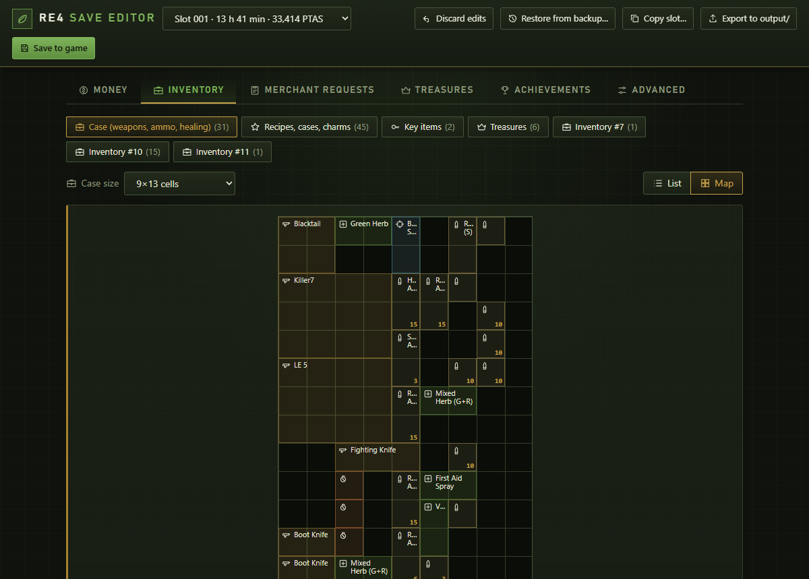
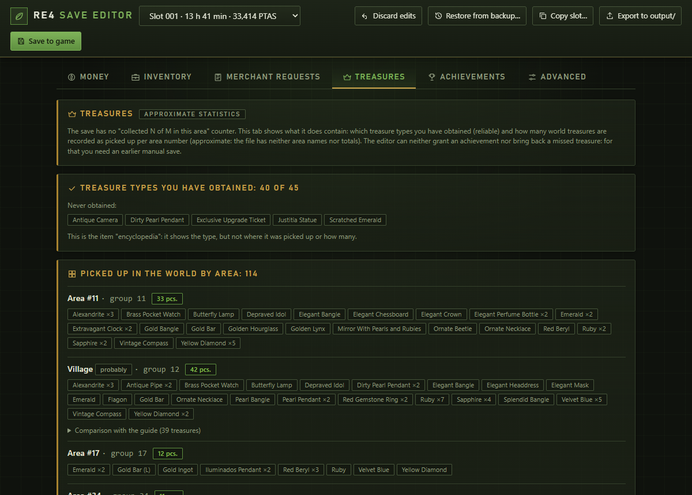

# RE4 Remake Save Editor

An unofficial, local web-based save editor for **Resident Evil 4 (2023 remake) on Steam** (Windows).
It runs on your own computer, opens in your browser and never sends anything over the network.

> **Not affiliated with Capcom or Valve. Use at your own risk.**
> Editing saves can corrupt them. The editor makes a backup before every write, but keep your own copies too.

## Features

- **Money**: Pesetas and Spinel.
- **Inventory** (attaché case, key items, treasures, recipes/charms):
  search, category filter, sorting; edit counts, ammo, durability and item IDs;
  **add** items from a catalog of ~220 items, **duplicate**, **delete**;
  **case size** selector; a **case map** with drag & drop and rotation; **weapon upgrade levels**.
- **Merchant requests**: shows the goals of every request and can mark the goals as completed.
- **Treasures**: which treasure types you have obtained and how many world pickups are recorded per area (approximate).
- **Achievements**: reads your local Steam achievement cache (read-only) and shows progress hints computed from the save.
  It cannot unlock achievements.
- **Safety**: a "game is running" warning, an unsaved-changes indicator, a summary of every change before writing,
  automatic backups, restore from a backup or from your own file, and copying one slot into another.
- **Advanced**: a raw tree view of every field in the save file with search.

## Screenshots

| | |
|---|---|
|  |  |
|  |  |
|  |  |

## Requirements

- Windows 10 / 11, Steam version of Resident Evil 4 (2023)
- [Node.js](https://nodejs.org) 20 or newer and [git](https://git-scm.com)
- Internet access for the first build (downloads a portable .NET SDK, which is a few hundred MB)

## Quick start

```text
git clone https://github.com/distrix11/RE4-Remake-Save-Editor.git
cd RE4-Remake-Save-Editor
build.bat     (one time: downloads and builds the encryption helper)
start.bat     (opens http://localhost:4784 in your browser)
```

1. **Close the game** and consider turning off Steam Cloud for RE4 (otherwise Steam may restore the old file).
2. Pick a slot in the drop-down list at the top, edit, then press **Save to game**. A summary of the changes is shown first.
3. Use **Restore from copy...** to undo a write at any time.

The save folder (`<Steam>/userdata/<account>/2050650/remote/win64_save`) is detected automatically.
If detection fails, copy `app/config.example.json` to `app/config.json` and set `saveDir`.

## How it works

Steam save files are encrypted with the account's SteamID. Decryption and encryption are delegated to
[LimebrellaSharp](https://github.com/mi5hmash/LimebrellaSharp). The decrypted data is a reflection-style
binary format; field names are hashed and are resolved with the class templates from
[RE_RSZ](https://github.com/alphazolam/RE_RSZ). See [FORMAT.md](FORMAT.md) for what is known about the format.
Edits are applied in place, and structural changes (adding or removing items) re-emit the file with the
alignment recomputed. Nothing is written to the game folder without a backup.

## Known limitations

- Item sizes on the case map are **estimates** inferred from real layouts; items may look different in game.
- The maximum valid weapon upgrade level depends on the weapon and is not enforced.
- Weapons cannot be added (copy an existing one instead); exclusive upgrades are not editable.
- Names of merchant requests are not stored in the save; the mapping is partly inferred and marked in the UI.
- The item catalog is community-compiled and may contain mistakes.
- Tested on a limited set of saves and one game version. Game patches may change the save format.
- Windows and the Steam version only.

## Contributing

Issues and pull requests are welcome. **Never attach your save files to an issue** (they contain your account data);
describe the problem and include the server log instead.

## License

[MIT](LICENSE). Third-party components and data sources: see [THIRD_PARTY_NOTICES.md](THIRD_PARTY_NOTICES.md).
